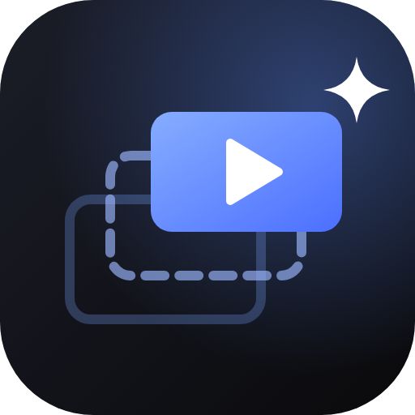
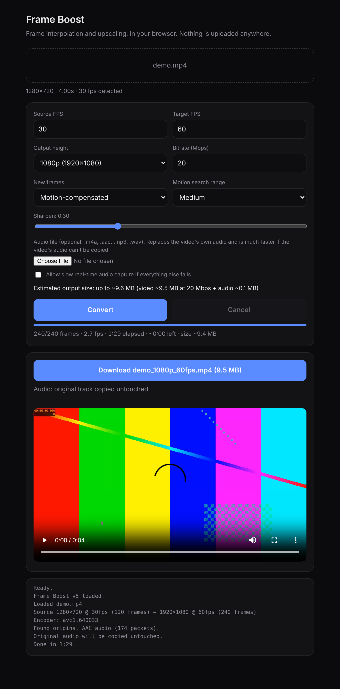
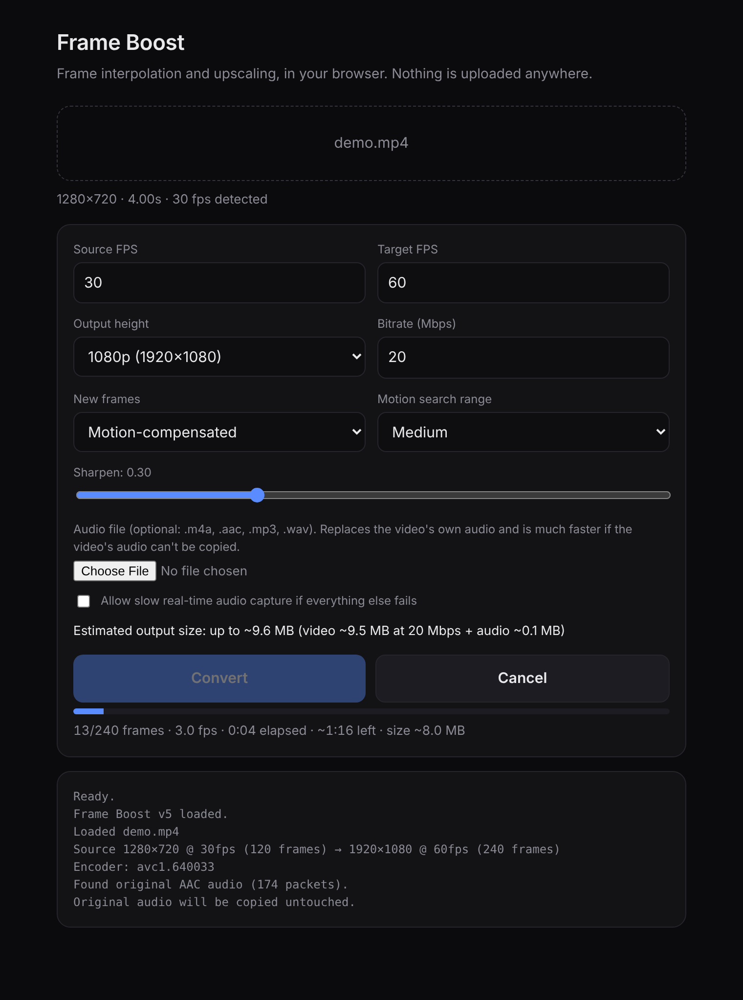

<div align="center">



# Frame Boost

**Turn 30 fps into real 60 fps and upscale 720p to 1080p, right in your browser.**

No installs. No uploads. No watermarks. Your video never leaves your device.

### [Open Frame Boost →](https://vansonv.github.io/FrameBoostClips)


<br>



</div>

---

## What it does

Frame Boost takes a video and gives you back a smoother, sharper one.

- **Real frame generation.** New frames are built from the motion between existing frames, not copied. A 30 fps clip becomes a true 60 fps clip.
- **Upscaling.** 720p to 1080p, with options for 1440p and 4K. It uses bicubic resampling with an adjustable sharpen control.
- **Your audio, untouched.** The original AAC track is copied straight into the new file with no re-encoding, so quality and sync stay exactly as they were.
- **Fully private.** Everything runs locally using your GPU and your browser's built-in video encoder. There is no server, no account and no upload.
- **Install it like an app.** Add it to your home screen and it opens full screen with its own icon. After the first visit it also loads offline.
- **Built for long runs.** While converting it keeps your screen awake, shows progress in the tab title, and sends a notification when your video is ready.
- **Live size estimate.** See roughly how big the output will be before you start, and a running projection while it converts.

## Quick start

1. Open **[vansonv.github.io/FrameBoostClips](https://vansonv.github.io/FrameBoostClips)** in Chrome or Edge.
2. Choose your video. The source frame rate is detected automatically.
3. Pick your target frame rate and output resolution (defaults are 60 fps and 1080p).
4. Press **Convert**, then download the finished MP4.

<div align="center">

</div>

## How it works

| Step | What happens |
| --- | --- |
| **1. Decode** | Frames are read from your video one at a time. |
| **2. Motion estimation** | Each pair of frames is compared in blocks to find how every part of the picture moved. |
| **3. Interpolation** | A WebGL shader builds the in-between frame by sampling both neighbours along the motion paths and blending them. Where motion can't be matched reliably, it falls back to a plain blend, and hard scene cuts are held instead of smeared. |
| **4. Upscale and sharpen** | The same shader resamples to the target resolution with bicubic filtering plus optional sharpening. |
| **5. Encode and mux** | Frames go to the browser's hardware-accelerated H.264 encoder and are written to an MP4 together with the original audio. |

## Settings

| Setting | Description |
| --- | --- |
| Source FPS / Target FPS | Any ratio works, for example 24 → 60 or 30 → 120. |
| Output height | 1080p, 1440p, 4K, or keep the source size. |
| Bitrate | Video bitrate in Mbps. Higher means better quality and a larger file. |
| New frames | Motion-compensated (best quality) or simple blend (fastest). |
| Motion search range | How far the tool looks for movement. Use larger for fast action. |
| Sharpen | Adjustable edge sharpening applied during upscaling. |
| Audio file (optional) | Supply an `.m4a`, `.aac`, `.mp3` or `.wav` to use instead of the video's own audio. |

## Install on your phone

- **Android (Chrome):** open the site, tap **Install app** at the top of the page, or use the browser menu and choose **Add to Home screen**.
- **Desktop (Chrome / Edge):** click the install icon in the address bar.

Then launch it from your home screen like any other app.

## Requirements

- A recent **Chrome or Edge**, on desktop or Android. Frame Boost relies on the WebCodecs API for encoding.
- WebGL 2 support.
- An internet connection the first time the page loads, to fetch two small open-source libraries ([mp4-muxer](https://github.com/Vanilagy/mp4-muxer) and [mp4box.js](https://github.com/gpac/mp4box.js)).

## Good to know

- Keep the page open while it converts. Browsers can pause pages that are in the background, so Frame Boost keeps the screen awake and plays an inaudible tone to reduce that, but a phone can still stop it if it runs low on memory or battery.
- Processing happens frame by frame in the browser, so long or very high-resolution videos take time and memory. Short clips are the sweet spot.
- Interpolation works best on footage with smooth, steady motion. Fast, chaotic movement or heavy motion blur can produce visible artefacts.
- Copying the original audio works with AAC audio in MP4 and MOV files. For other audio, Frame Boost re-encodes it, or you can supply an `.m4a` for the fastest result.
- Output is H.264 video in an MP4 container.

## Running it yourself

It's a single static page, so there is nothing to build.

```bash
git clone https://github.com/vansonv/FrameBoostClips.git
cd FrameBoostClips
# open index.html in Chrome or Edge, or serve it locally:
python3 -m http.server 8000
```

## Credits

Created by **Vans**. Built on the browser's WebCodecs and WebGL APIs, with [mp4-muxer](https://github.com/Vanilagy/mp4-muxer) and [mp4box.js](https://github.com/gpac/mp4box.js).

---

<div align="center">

If Frame Boost helped you, a ⭐ on the repo is appreciated.

</div>
